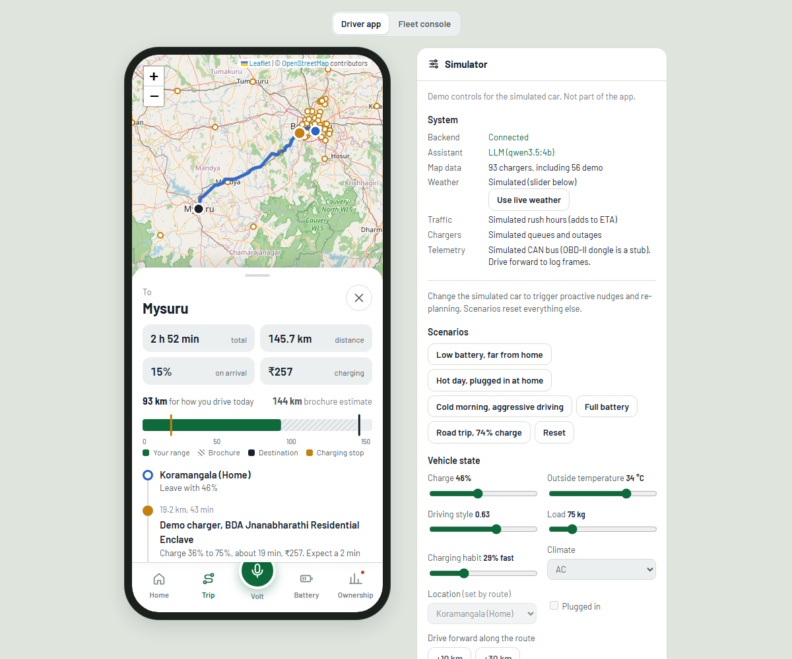
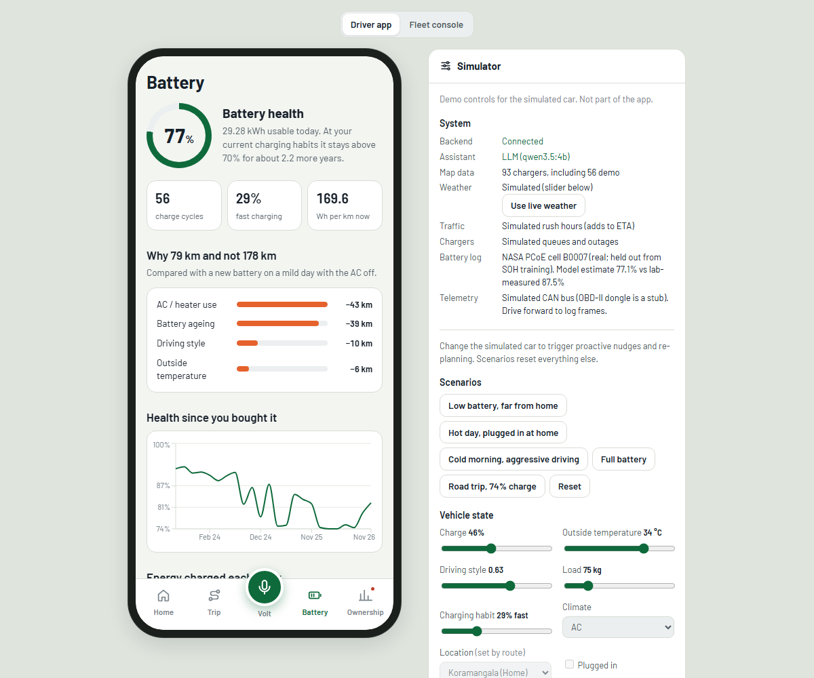
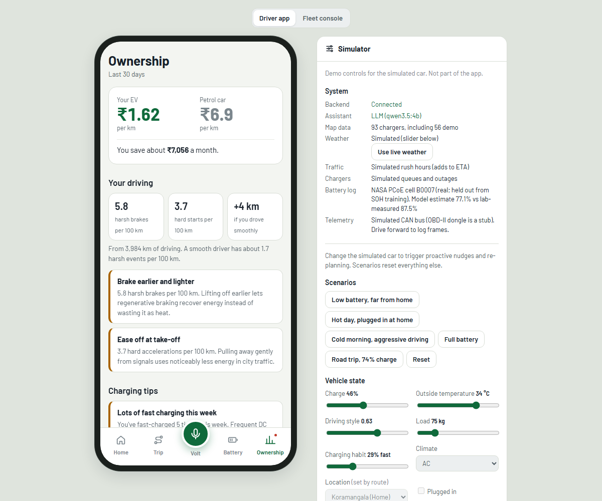
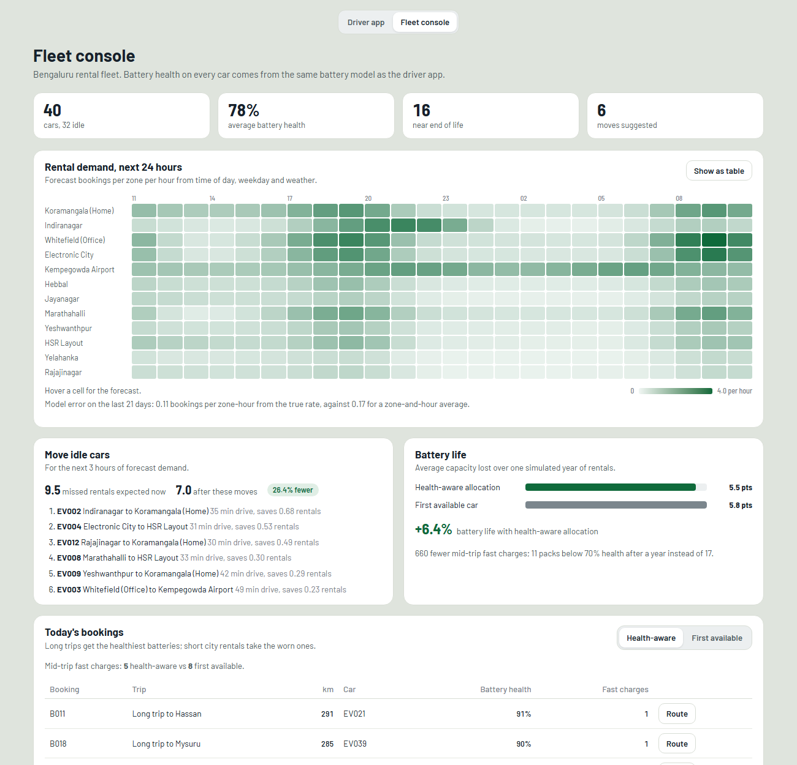

# AI for Optimizing EVs: Volt and the battery-intelligence core

Final-year project, Dept. of AIML, AMC Engineering College.
**Project page:** https://problematicpp.github.io/ev-voice-assistant/



One shared **battery-intelligence core** (PyTorch SOH, personalised range, RUL, Shapley range attribution
and a battery guard) feeds four consumers:

```
Voice assistant "Volt" ──┐
Companion app ───────────┤──► Battery-Intelligence Core  (backend/app/battery_core)
Route & charging planner ┤      SOH model · personalised range model · RUL / degradation
Fleet management ────────┘      Shapley attribution · battery guard (every action passes it)

Fed by: simulated OBD-II/CAN telemetry, charging history, weather (live Open-Meteo or simulated),
        simulated traffic and charger availability, OpenStreetMap chargers + demo chargers
```

Everything runs locally, with no API keys and no paid services. Live weather is optional and falls back
to the simulator offline. The battery-health model is trained and tested on **real** battery-ageing data
(NASA), and the demo car and fleet replay real batteries' logs. Trips, owner history and fleet demand are
synthetic. Roads, places and most charger locations are real (OpenStreetMap).

A Volt turn:
```
mic ─► faster-whisper (STT, GPU) ─► Ollama qwen3.5:4b (tool call)  ── or the rule-based parser if Ollama is down
    ─► function router ─► battery guard ─► core / planner / companion / fleet
    ─► LLM phrases the reply from the tool's facts ─► Piper TTS
```

---

## 1. Prerequisites (Windows; macOS/Linux work with the usual path changes)

| Tool | Version | Install |
|---|---|---|
| Python | **3.12** | `uv` fetches it for you (below) |
| uv | any recent | `pip install uv` |
| Node.js | 18+ (tested on 24) | nodejs.org |
| Ollama | latest | `winget install Ollama.Ollama` or https://ollama.com/download |

ffmpeg is not needed. An NVIDIA GPU is optional and is used automatically when present.

## 2. Set up from a fresh clone

```powershell
git clone https://github.com/ProblematicPP/ev-voice-assistant.git
cd ev-voice-assistant\backend

# Python environment
uv venv --python 3.12 .venv
uv pip install --python .venv\Scripts\python.exe -r requirements.txt
uv pip install --python .venv\Scripts\python.exe torch --index-url https://download.pytorch.org/whl/cpu

# Data: downloads the Karnataka OSM extract (~130 MB) and NASA's real battery-ageing data (~210 MB),
# once; builds the road graph, places demo chargers, and generates trips, owner history and the
# rental fleet (~8-10 min). The demo car and the fleet replay real NASA cells' battery logs.
.venv\Scripts\python.exe -m data_gen.generate_all

# Models (about 1 minute in total on CPU). Weights + scalers are saved in backend/models/
.venv\Scripts\python.exe -m training.train_soh       # SOH MLP on real NASA cells (+ synthetic one for comparison)
.venv\Scripts\python.exe -m training.train_range     # fleet Wh/km MLP + owner fine-tune
.venv\Scripts\python.exe -m training.train_demand    # fleet demand forecaster

# Optional: the real-battery experiments behind the SOH model (~1.5 and ~5 min)
.venv\Scripts\python.exe -m training.validate_soh_nasa      # real vs synthetic training, baselines
.venv\Scripts\python.exe -m training.compare_soh_features   # why "change since new" features

# Tests (~2 min)
.venv\Scripts\python.exe -m pytest -q

# Local LLM (~3.3 GB)
ollama pull qwen3.5:4b

# Frontend packages
cd ..\frontend
npm install
```

`backend/data/` and `backend/models/` are generated, not committed. Once trained, the app only loads the
saved weights; it never retrains at startup.

## 3. Run

```powershell
# Terminal 1: backend (API on :8000, docs at http://localhost:8000/docs)
cd backend
.venv\Scripts\python.exe -m uvicorn app.main:app --port 8000

# Terminal 2: frontend (UI on :5173, proxies /api to the backend)
cd frontend
npm run dev
```

Open http://localhost:5173. On first start the backend downloads Whisper `small.en` (~480 MB) and the
Piper voice (~60 MB) once, and warms up the LLM (allow ~30-60 s before demoing).

- **Driver app** (the phone): Home, **Trip** (map, route, range ribbon), **Volt** (chat and voice), **Battery**,
  **Ownership**. Screens can be linked directly, e.g. `http://localhost:5173/#battery`.
- **Simulator** (the panel beside the phone, not part of the app): charge, temperature, AC, driving
  style, charging habit, location, one-click scenarios, "drive forward", live weather, system status and
  the last assistant turn (tool, arguments and guard verdict).
- **Fleet console** (switch at the top): demand heatmap, rebalancing moves, both allocation policies,
  round-trip rental routes and the battery-life result.

| Battery | Ownership | Fleet console |
|---|---|---|
|  |  |  |

## 4. Evaluate

```powershell
cd backend
.venv\Scripts\python.exe -m eval.run_all          # full run, ~4 min (needs Ollama for the LLM row)
.venv\Scripts\python.exe -m eval.run_all --quick  # skips the LLM and voice runs
```

This prints a table and writes [`results/metrics.md`](results/metrics.md) (plus `metrics.json`). It covers:

- SOH and range accuracy (MAE and MAPE on held-out cells and trips, fleet vs personalised)
- the battery-aware planner vs a static brochure-range baseline over 108 trips
- assistant task success and latency through the LLM and the fallback, plus voice timings and the GPU
- fleet battery longevity, demand-forecast error and rebalancing

Without an NVIDIA GPU the speech models run on CPU, and the report says so.

## 5. Demo

See [`DEMO_SCRIPT.md`](DEMO_SCRIPT.md) for the 5-minute review sequence and fallbacks.

## 6. How it works

### Battery-intelligence core (`backend/app/battery_core`)

| Piece | What it does |
|---|---|
| `soh_model.py` | MLP on 10 BMS cycle features, **trained on real NASA cells**. Resistance, voltage and temperature are measured as change since the battery was new. 4.8 SOH points MAE on 7 real cells it never saw (see below) |
| `range_model.py` | MLP predicting Wh/km from weather, HVAC, driving style, speed, load and SOH. A fleet model is fine-tuned on the owner's own trips (`range_model_owner.pt`). Range = usable kWh × SOH × SOC ÷ Wh/km; the brochure figure (312 km × SOC) is exposed alongside |
| `degradation.py` | SOH projection and remaining useful life (years to 70%) under a charging habit; drives the 2-year resale projection and fleet longevity |
| `attribution.py` | Exact Shapley values over AC/heater, battery ageing, driving style, temperature and load (32 batched model calls) |
| `guard.py` | `check(action, ...)`: the single gate every action passes. Returns allow / modify / refuse, a reason and, when relevant, a proposed charging stop |
| `core.py` | `BatteryCore`, the only entry point. A test fails if any other module imports the SOH, ageing or degradation code directly |

### Battery health on real batteries (NASA ageing data)

The shipped SOH model is trained on **real** batteries: NASA Ames' public Li-ion ageing dataset
(34 real 18650 cells, Saha & Goebel 2007). `data_gen/nasa_battery.py` turns each cell's measured
voltage, current, temperature and impedance into the model's 10 BMS features. SOH is the measured
capacity divided by the rated 2 Ah.

- **Split by cell, fixed in advance:** 22 cells train, 5 validate and 7 are held out for testing:
  B0007, B0027, B0031, B0036, B0043, B0047 and B0055, spanning 4–43 °C and different loads.
- **Result on the 7 held-out cells:** **4.8 SOH points MAE (6.5% MAPE, R² 0.76).**
  - Per cell: B0031 0.7, B0043 2.3, B0036 3.7, B0055 4.2, B0007 6.2, B0047 7.1, B0027 12.3.
  - B0027 is a short 28-cycle run on an unusual square-wave load.
- **The demo car's battery log is a held-out real cell (B0007),** replayed from new to the cycle where the
  lab measured 87.5%. The app shows the model's estimate, as a real car would: **77%**. It underestimates
  this cell by about 10 points; the simulator panel shows both numbers.
- **The fleet's 40 cars replay held-out cells** at random points in service (lab-measured ≥ 70%). Their
  estimates are 4.7 points from the lab values on average.

**Why "change since new" features.** New cells of the same type differ a lot: NASA's start between 28
and 135 mΩ. An absolute reading can make a healthy cell look worn; B0036 was read as 78% when it was
90%. A battery system tracks drift from its own baseline instead. In a fair comparison
(`training/compare_soh_features.py`: 3 seeds × 3 held-out protocols), the drift features averaged 5.2
points against 6.3 for absolute values. Absolute values do slightly better only on the 4 classic cells,
which were all tested the same way.

**Real-trained vs synthetic-trained** (`training/validate_soh_nasa.py`):

| Held-out real cells | MLP trained on real cells | Cycle count only | Average SOH | Same MLP trained on synthetic cells |
|---|---|---|---|---|
| Classic B0005/6/7/18, leave-one-cell-out | **≈3.3 pts** | 4.2 pts | 7.9 pts | 18.6 pts |
| All 34 cells, 5 folds by cell | **≈7.0 pts** | 12.4 pts | 12.4 pts | 25.8 pts |

Synthetic training does not transfer to real batteries, and fine-tuning a synthetic model on real cells
did worse than training on real cells alone. So the app ships the real-trained model. The synthetic
generator is kept for things real data doesn't cover (habit and fleet simulations).

**Not learned:** future degradation and remaining life (`degradation.py`) use a semi-empirical formula with
hand-chosen constants, not a model fitted to these cells.

### Route and charging-stop planner (`backend/app/routing`)

- **Roads:** fastest paths with Dijkstra on the real OSM graph.
- **Energy:** each road edge's kWh comes from the range model under live conditions.
- **Stop search:** charging stops are chosen by A* over (charger, target-SOC) states. A transition is allowed only if arrival charge stays above the safety floor. The cost is driving + charging + queue minutes, with the charge-time taper above 80%.
- **Output:** distance, duration including stops, traffic delay, arrival charge, stop name, charge time, ₹ cost and a polyline.
- **Mid-trip re-planning:** a detour re-plans from the current position.
- **Not reinforcement learning:** the deck cites DQN/RL-style stop selection as related work. This project uses graph search with learned energy costs; RL is not implemented.

### Volt (`backend/app/assistant`)

- **Speech:** faster-whisper STT (GPU when available), Piper TTS (CPU).
- **LLM:** Ollama `qwen3.5:4b` with native tool calling over 16 tools.
- **Safety nets:**
  - The rule-based parser takes over when Ollama is down or fails.
  - When the model answers a clear command in prose, the parser acts on it instead.
  - When the model picks only a lookup for a clear command (e.g. a range check for "take me to Mysuru"), the command wins.
- **Proactive nudges:** checked every 8 s and pushed over the WebSocket, then shown and spoken in the UI. Triggers:
  - a route that is no longer safe
  - low charge far from home
  - pre-cooling on a hot day
  - an unusual range drop
  - harsh braking on the last drive
  - fast charging too often
- **Hardware stubs:** assisted driving, pre-cooling and the OBD-II dongle are stubs, clearly marked in code (`assistant/stubs/`, `telemetry.ObdDongle`).

### Companion and fleet

- **Companion** (`app/companion`): charging coach from the owner's sessions, eco-driving coach from
  telemetry, 30-day cost vs petrol, and resale value with a 2-year projection by charging habit.
- **Fleet** (`app/fleet`):
  - a 40-car rental fleet whose battery logs replay real held-out NASA cells; each car's SOH is estimated by the core
  - battery-aware allocation (healthy packs take long trips, worn packs short city rentals)
  - a PyTorch demand forecaster (zone × hour × weather)
  - Poisson rebalancing that estimates missed rentals saved
  - round-trip rental routes on the shared planner
  - a one-year longevity simulation against a first-available baseline

### External inputs (`app/inputs`)

Small provider classes a real API can replace:
- `LiveWeather` uses Open-Meteo (free, no key) and falls back offline.
- `SimulatedTraffic` adds rush-hour delay to ETAs.
- `SimulatedStations` simulates charger queues and outages, which the planner weighs.

## 7. Layout

```
backend/
  app/
    battery_core/   shared core: nn, soh_model, range_model, degradation, attribution, guard, core
    routing/        OSM network, planner, mid-drive re-planner
    assistant/      STT, TTS, Ollama client, tools, router, fallback parser, nudges, pipeline, stubs/
    companion/      charging coach, eco coach, cost, resale
    fleet/          fleet manager + demand model
    inputs/         weather / traffic / charger-availability providers
    telemetry.py    simulated CAN bus + harsh-event detection (OBD-II dongle stub)
    api/            FastAPI routers + WebSocket hub
  data_gen/         OSM download + graph build, demo chargers, synthetic cells/trips/owner/fleet
  training/         train_soh, train_range, train_demand
  eval/             run_all (writes ../results/metrics.md)
  tests/            pytest suite
frontend/src/       React: phone app screens, fleet console, simulator dock
results/            evaluation output
```

## 8. Data

| File | Size | Purpose |
|---|---|---|
| `network.json` | 39,755 nodes | **Real** Karnataka roads, places, 37 OSM car chargers, POIs |
| `demo_chargers.json` | 56 | Seeded demo chargers, labelled as demo in the UI. Six anchor the intercity destinations (Mysuru, Hassan, …) where OSM lists none |
| `cell_cycles.csv` | ~30k cycles, 36 synthetic cells | the synthetic comparison model (shows synthetic training does not transfer) |
| `trips.csv` | 24k segments | fleet Wh/km training data |
| `vehicle_bms_history.csv` | ~37 cycles | the demo car's BMS log: real NASA cell B0007 (held out), replayed from new |
| `owner_trips.csv`, `charging_history.csv` | 90 days | personal range fine-tune, coaching, cost |
| `fleet_*.csv` | 40 cars, 180 days × 24 h × 12 zones | fleet SOH, demand model, bookings |
| `nasa_cycles.csv` | 2,459 discharge cycles, 34 **real** cells | trains and tests the shipped SOH model; the demo car and fleet replay held-out cells |

## 9. Honest limitations

- The battery-health model and the battery logs are real (NASA lab cells). Trips, owner history, fleet
  demand and the range model's training data are synthetic. The routing and fleet comparisons are
  simulations.
- NASA's are small 18650 lab cells cycled hard, so they age about 6× faster per cycle than a car pack.
  The demo car's log is therefore short (about 50 cycles), and a car-pack model would need car-pack data.
- The degradation projection, remaining life and fleet battery-life result come from a semi-empirical
  ageing formula with hand-chosen constants, not a model fitted to real data.
- Hardware features (OBD-II/CAN, assisted-driving cameras, pre-cooling) are stubs.
- OSM has few Karnataka car chargers and almost no power/price data. Those values are estimated and flagged,
  and the demo chargers are invented to give the planner choices.
- No elevation data. Traffic and charger queues are simulated.
- Charging-stop selection is graph search, not reinforcement learning.
- One English Piper voice. The 4B LLM occasionally picks a different tool; the safety nets above catch the
  common cases, and every executed action still passes the battery guard.

Map data © OpenStreetMap contributors, [ODbL](https://www.openstreetmap.org/copyright).
Weather from [Open-Meteo](https://open-meteo.com/) (CC BY 4.0).
